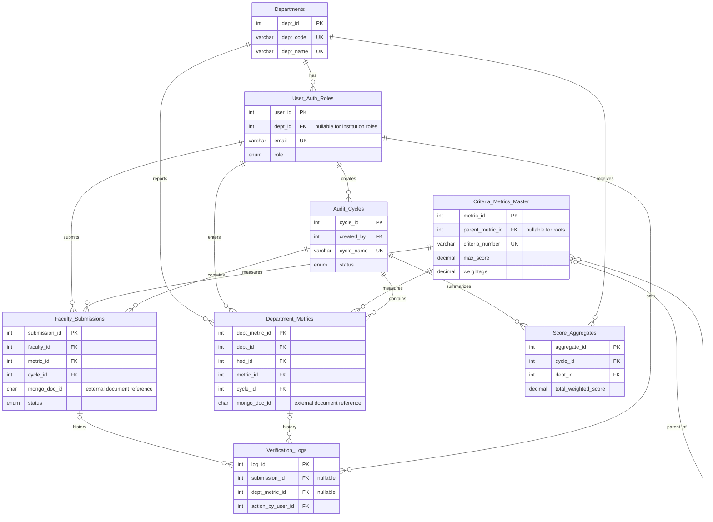

# IQAC entity relationship diagram

This diagram covers all eight core tables in 01_schema.sql. PK means primary key; FK means foreign key. Additional portal support tables are defined in 07_portal.sql. The SQL files are the authoritative definition of all columns, checks and indexes.

A verification log references exactly one submission or department metric, enforced by a CHECK. Each cycle/department pair has at most one score aggregate. Each department/metric/cycle combination has at most one department metric. Faculty submissions have a unique cycle/faculty/DOI-or-ISBN combination; NULL identifiers require additional duplicate handling.

MongoDB evidence links are application-managed references, not cross-database foreign keys. The outbox synchronizes evidence changes. The self-parent trigger rejects a metric directly parenting itself; this alone does not establish arbitrary cycle detection in the metric tree.

For the viva, explain one-to-many relationships, nullable institution-level department membership, primary and foreign keys, and why evidence documents live separately in MongoDB. GitHub renders this Mermaid diagram when viewing the file.
